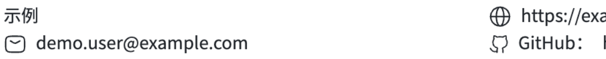
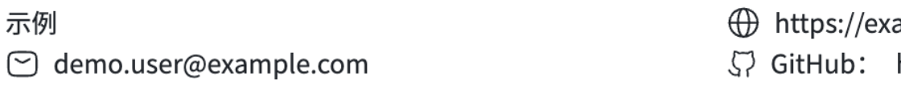

# Blue Line Chrome fault reproduction and acceptance

The reported contact-icon misalignment was reproduced from the original
commercial application's Chrome scene at `http://localhost:3000`. The user
confirmed that original scene showed the problem and that the corrected image
was aligned. This acceptance concerns the reproduced scene; the earlier camera
scale-1 comparison alone was not fault-reproduction or fix evidence.

## Reproduction and correction

The original installed package matched `395d261` across all 96 JavaScript files
checked. With the same private resume and captured camera, an isolated host
using that package reproduced the original contact clip byte-for-byte. The
[reproduction bridge](images/blue-line/fault-reproduction-bridge.json) records
that connection between the original application and the isolated baseline.
Private screenshots and detailed local reports are not published here.

In the earlier controlled scale-1 captures, the shared-component refactor at
`f06bcc6` preserved the installed baseline's contact pixels; refactoring alone
did not make the correction. Commit `640f5ba` added
the scoped header adjustment: `contactIcon.marginTop` stayed at `-6`, while
Header used `headerContactIcon.marginTop: -8`. Section custom-field icons kept
their previous placement in DOM and PDF output. The subsequent comparison in
the reproduced scene isolated movement to the three contact SVGs, with visible
text and pixels outside their regions unchanged; the user accepted the after
image. These observations do not establish camera scaling as the root cause.

## Public illustrations and capture conditions

The public images below are a separate run using the
[anonymous fixture](fixtures/blue-line-contact-resume.json). They illustrate the
same camera and correction; they are not the original private screenshots or
byte-identical substitutes for the private reproduction bridge.

Before, the reproduced installed-package baseline:



After, the header-only correction:



[Editor before](images/blue-line/chrome-fault-editor-before.jpg) and
[editor after](images/blue-line/chrome-fault-editor-after.jpg) show the surrounding
application. The right-side panel remained open as in the original scene, so
part of the website/GitHub text is occluded. The comparison concerns the visible
clip and does not make claims about text hidden behind that panel.

The captured camera used pan `(111.55, -96.79)` and scale `1.238`, browser zoom
1x, a 1440 x 660 CSS-pixel viewport and DPR 2. In the private reproduction, the
canvas CSS box was `(x=412.7489929, y=2.25, width=982.9719238,
height=2167.9797)`. Public-fixture canvas height depends on its different content.
The contact clip was `(465, 95, 560, 55)` CSS pixels, captured at CDP scale 1 as
1120 x 110 PNGs. The [public comparison](images/blue-line/chrome-fault-comparison.json)
records the anonymous clip hashes, measured SVG movement and unchanged-region
checks. Original PNG bytes are retained; JPEG editor overviews provide context
and are not used for lossless pixel assertions.

## Reproduce in isolated application hosts

1. Build and pack the baseline and corrected kit versions in separate worktrees.
   Install the corresponding immutable package with a local `file:` dependency
   in disposable hosts at `7508be3`, following the [consumer guide](consumer-migration.md).
   Preserve the non-template lock, fonts and PDF patches; build the host's
   `@magic-resume/env` and `@magic-resume/genui` packages before starting it.
2. Keep cloud sync disabled. Import the same anonymous fixture through each real
   dashboard and choose Blue Line. Host `7508be3` strips `info.customFields` on
   import: re-add the same header contact in both editors with name `GitHub`,
   value `https://example.com/xxxxxxxx` and icon `github`.
3. Use this identical development-only handler in each disposable host's
   `ResumePreviewPanel.tsx`. Open the real editor with
   `?qaScene=commercial-original-as-found`, without `qaScale`, and retain the
   right-side panel. The values came from the original application's captured
   DOM camera; the handler changes only preview-camera placement.

   ```tsx
   onInit={(controls) => {
     // Local acceptance harness only: keep PDF rendering untouched and make
     // camera placement identical across the two disposable worktrees.
     const requested = process.env.NODE_ENV === 'development'
       ? new URLSearchParams(window.location.search).get('qaScale') : null;
     const scene = process.env.NODE_ENV === 'development'
       ? new URLSearchParams(window.location.search).get('qaScene') : null;
     if (requested === '1' || requested === '0.5') {
       controls.setTransform(0, 0, Number(requested), 0);
     } else if (scene === 'commercial-original-as-found') {
       controls.setTransform(111.55, -96.79, 1.238, 0);
     } else {
       controls.centerView(0.5, 0);
     }
   }}
   ```

4. Restart after changing the installed package, reload Chrome and capture at
   the geometry above. Check PNG signatures and dimensions. Preserve PDF
   generation, fonts and rasterization; do not replace renderer files inside an
   existing application's `node_modules` or use a replacement test page.

## Package identity and regression checks

The disposable hosts used the same host commit `7508be3`, non-template
versions, fonts and PDF patches. All 198 installed package files matched their
immutable archive, and the corrected installed `dist` matched its source build.
The packages retained version `1.1.1`; these SHA256 hashes identify local inputs:

- Installed-package baseline (`395d261`):
  `6f305c97cd75e7a4e72be52f19393d4f5cdfb83688eff73806d412b055faa13a`.
- Shared-refactor control (`f06bcc6`):
  `60e0d4c235f45ceeb9f097ecd79c05411d2dc39a813c885f3baf862aba2df6a4`.
- Corrected package (`640f5ba` rendering code):
  `fea3f24dc7d79f68beb11e1433a87e16aa9013ce97f2f1aaecc4c884d4011b98`.
- Anonymous fixture:
  `88fc3bc3f17039c1e27f42dc1ee9d30e40e27ac8080f88838d05dfd28f21dee3`.

The [font filename/hash manifest](fixtures/blue-line-full-font-sha256.json)
contains no font payloads. Build, lint, all 260 template tests, package inspection,
clean consumer installation and the legacy freeze guard passed. DOM/PDF tests
keep Header tuning separate from section custom-field icons. Private and public
fixtures each matched main across all 19 legacy templates' DOM, PDF markup and
PDF raster output. Historical main/layout evidence remains in
[Blue Line validation](blue-line-validation.md). These checks cover the tested
inputs, not every possible resume, font, zoom or token combination.

## Supplement: the earlier camera scale-1 experiment

The [older before PNG](images/blue-line/chrome-contacts-before.png),
[after PNG](images/blue-line/chrome-contacts-after.png),
[editor before](images/blue-line/chrome-editor-before.jpg),
[editor after](images/blue-line/chrome-editor-after.jpg) and
[report](images/blue-line/chrome-contact-comparison.json) remain available.
That separate 1440 x 604/DPR-2 capture used camera `(0, 0, 1)`, a 1588 x 2845
canvas bitmap and CSS clip `(350, 150, 735, 55)`, producing 1470 x 110 PNGs.
Its three SVGs moved up one CSS pixel with unchanged text/outside regions. Both
images had appeared normal; this experiment alone did not reproduce the fault.

The retained [motion verifier](../packages/resume-templates/scripts/check-chrome-contact-motion.py)
requires Python, Pillow and NumPy and is specific to those older clips. With a
fresh report path, run it on `chrome-contacts-before.png` and
`chrome-contacts-after.png` using `--expected-dy -2`; a separate run with
`--expected-dy 0` must fail. It tests controlled screenshot movement, not optical
correctness, and is not the verifier for the new 1120 x 110 fault-scene clips.
