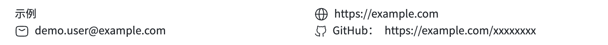
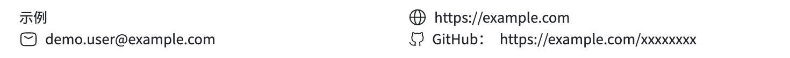

# Blue Line Chrome contact validation

The compact Header now raises contact icons by 1 CSS pixel relative to
`f06bcc6`, while preserving text placement and section custom-field icons.
The screenshots below come from the real application's Chrome PDF canvas.
Visual acceptance of the reported symptom remains pending.

## Versions and inputs

- The originally installed package matched `395d261` in all 96 JavaScript files
  checked. It already contained the earlier contact adjustment.
- The shared-component refactor at `f06bcc6` matched that installed version's
  contact pixels in Chrome. Refactoring alone did not add a further correction.
- Commit `640f5ba` adds the header-only optical adjustment. The common
  `contactIcon` margin stays at `-6`; Header uses `headerContactIcon` at `-8`.
  A centered flex row applies half the margin difference to the icon center,
  so the two-pixel margin change raises each icon by one CSS pixel. DOM and PDF
  use the same CSS-pixel metrics, converted to PDF points at the boundary.
- Historical main `148cd7a` is a separate layout control; the older main/shared
  layout evidence remains in [Blue Line validation](blue-line-validation.md).

Both disposable application checkouts used host commit `7508be3`, identical
non-template dependencies, fonts and PDF patches. All 198 installed package
files matched their immutable archive, and the candidate's installed `dist`
matched its built source. The package version remains `1.1.1`; hashes identify
these local packages, not a new npm release:

- Before (`f06bcc6`): `60e0d4c235f45ceeb9f097ecd79c05411d2dc39a813c885f3baf862aba2df6a4`.
- After (`640f5ba` rendering code): `fea3f24dc7d79f68beb11e1433a87e16aa9013ce97f2f1aaecc4c884d4011b98`.
- [Public fixture](fixtures/blue-line-contact-resume.json):
  `88fc3bc3f17039c1e27f42dc1ee9d30e40e27ac8080f88838d05dfd28f21dee3`.
- [Font filename/hash manifest](fixtures/blue-line-full-font-sha256.json).
  Font payloads and private resume data are not included.

## Actual Chrome before and after

Before, shared components at `f06bcc6`:



After, header-only optical adjustment:



[Editor overview before](images/blue-line/chrome-editor-before.jpg) and
[after](images/blue-line/chrome-editor-after.jpg) provide application context.
Those overviews are original JPEG bytes. The quantitative comparison uses only
the lossless contact PNGs, copied without conversion or resizing.

Both captures used browser zoom 1x, DPR 2, a 1440 x 604 CSS-pixel viewport and
editor camera `(x=0, y=0, scale=1)`. The canvas began at `(323, 80)`, displayed
at width 794 CSS pixels, with a 1588 x 2845 bitmap. CDP captured CSS clip
`(350, 150, 735, 55)` at scale 1, producing 1470 x 110 native PNGs.

The [comparison report](images/blue-line/chrome-contact-comparison.json) records:

- Mail, globe and GitHub each move `(0, -2)` output pixels: `(0, -1)` CSS pixels.
- Foreground masks match exactly after translation at all five tested grayscale
  thresholds: `96`, `128`, `160`, `192`, `224`.
- All three text regions and pixels outside the SVG regions have zero changes.
  There are 1173 changed pixels inside the SVG regions.

A separate actual-Chrome run using the original private resume observed the
same one-pixel movement and unchanged text/outside pixels. Those artifacts
remain local. Movement checks do not prove the original root cause, establish
browser scaling as its cause, or replace a visual-acceptance decision.

## Reproduce

1. Build and pack the before/after kit versions in separate worktrees. Install
   the corresponding immutable archive through a local `file:` dependency in
   two disposable hosts at `7508be3`, following the [consumer guide](consumer-migration.md).
   Preserve fonts, PDF patches and other dependency versions; build the host's
   `@magic-resume/env` and `@magic-resume/genui` packages before starting it.
2. Keep cloud sync disabled. Through each real dashboard, import the same public
   fixture and choose Blue Line. Host `7508be3` strips `info.customFields` on
   import, so re-add the same contact through both editors: name `GitHub`, value
   `https://example.com/xxxxxxxx`, icon `github`.
3. Apply this identical temporary camera handler in each disposable host's
   `ResumePreviewPanel.tsx`. Open the real editor URL with `?qaScale=1` and
   collapse both side panels. This changes camera placement only; PDF generation,
   fonts, rasterization and production behavior remain unchanged.

   ```tsx
   onInit={(controls) => {
     const requested = process.env.NODE_ENV === 'development'
       ? new URLSearchParams(window.location.search).get('qaScale') : null;
     if (requested === '1' || requested === '0.5') {
       controls.setTransform(0, 0, Number(requested), 0);
     } else {
       controls.centerView(0.5, 0);
     }
   }}
   ```

4. Restart the candidate host after installing its package, reload Chrome and
   capture actual lossless PNGs using the geometry above. Check signatures and
   dimensions; JPEG overviews or Node-generated PDFs cannot substitute for them.

The [screenshot verifier](../packages/resume-templates/scripts/check-chrome-contact-motion.py)
requires Python, Pillow and NumPy. From the kit root, use a fresh output path:

```sh
python3 packages/resume-templates/scripts/check-chrome-contact-motion.py \
  docs/images/blue-line/chrome-contacts-before.png \
  docs/images/blue-line/chrome-contacts-after.png \
  --expected-dy -2 --report /tmp/blue-line-chrome-motion-green.json
```

Using `--expected-dy 0` with another fresh report must fail. The verifier checks
actual displacement, shape preservation, unchanged text and unchanged pixels
outside the three SVG regions; it does not assert optical correctness.

## Regression checks

Build, lint, all 260 template tests, package inspection, clean consumer
installation and the legacy freeze guard passed. Two new DOM/PDF tests ensure
Header tuning does not change section custom-field icons. Separate private and
public fixtures each matched main in all 19 legacy templates' DOM, PDF markup
and PDF raster output. These are results for the tested inputs, not every
possible font, zoom, token or resume combination.

Visual acceptance of the reported symptom remains pending.
