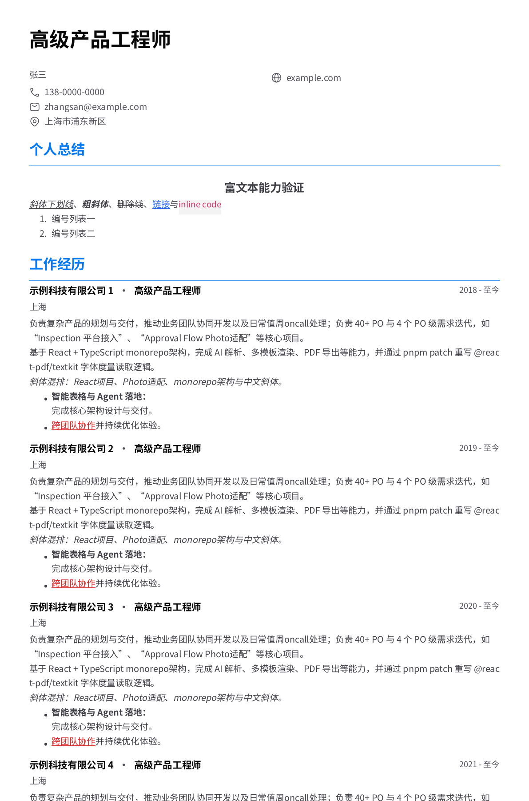
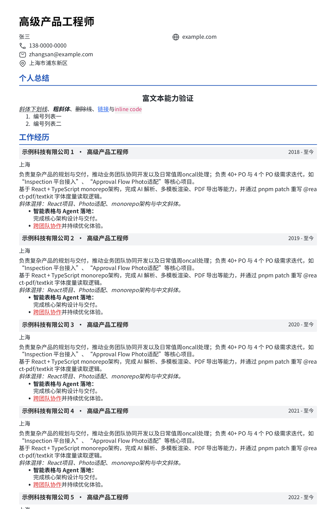

# Blue Line validation

This change belongs to `magic-resume-kit`. The kit has no application preview
server: the template package's `dev` script only watches TypeScript compilation.
The application's PDF canvas uses its installed template package, so refreshing
an application with a pinned npm dependency does not load this checkout.

## Package checks

Use Node >=22.13 and pnpm 10.28.1 (CI uses Node 24). From the repository root:

```sh
pnpm install --frozen-lockfile
pnpm build
pnpm lint
pnpm test
pnpm check:packages
pnpm test:consumer
```

Run the build before the tests: the build cleans workspace package outputs that
the tests import. The template suite contains 260 tests, including opt-in marker
alignment across base/custom template IDs, editable anchors, field aliases,
inline formatting, CSS units, URL precedence and nested-group visibility.

## Render PDFs locally

The existing PDF smoke script uses synthetic data and renders all 20 templates.
Supply the host's full Source Han Sans/Serif font files; fonts stay outside the kit.

```sh
export MAGIC_RESUME_FONT_DIR=/absolute/path/to/host/public/fonts/full
PDF_SMOKE_OUTPUT_DIR="$PWD/.artifacts/pdf-after" \
  pnpm --filter @magic-resume-kit/resume-templates test:pdf
```

Open `.artifacts/pdf-after/blue-line.pdf` and `classic.pdf` side by side. Check
contacts, wrapped bullet text, experience title bands and rich-text formatting.
The script also checks PDF structure and the host-required synthetic-bold patches.

For a historical comparison, create a separate checkout at `148cd7a`, install
and build it, and run the same command with the same fonts into a different output
directory. Compare that result with the current checkout; never render two
versions against different input data or fonts.

## Before and after evidence

For the separate application screenshot check, see [Blue Line Chrome contact
validation](blue-line-chrome-validation.md). It distinguishes the unchanged
shared refactor from the later header-only optical candidate; the layout
evidence below remains the historical main comparison.

These are the top 1800 raster pixels at 144 dpi, generated with the **unchanged
synthetic fixture** in `packages/resume-templates/scripts/render-pdf-smoke.mjs`.
They contain no private resume data. The baseline is main at `148cd7a`; the after
image is the shared-component implementation at `cbed815`. This comparison
includes the compact typography/layout changes from the branch's first commits.

Before - main, `148cd7a`:



After - shared components with compact presentation:



To reproduce the raster excerpts after rendering each version:

```sh
pdftoppm -png -r 144 -singlefile -H 1800 /path/to/before/blue-line.pdf before-main
pdftoppm -png -r 144 -singlefile -H 1800 /path/to/after/blue-line.pdf after-shared
```

Separate local validation used one private resume snapshot throughout. All 19
legacy templates matched `148cd7a` in DOM markup, PDF markup and PDF raster output
at 144 dpi. Blue Line's established compact output before and after component
unification matched at 192 dpi with zero changed pixels. These checks describe
that snapshot, not every possible custom token/data combination.

Historical alignment screenshots found from the previous evening already show
the compact V7 layout. They are not the main baseline and contain personal
contacts, so they are kept local rather than included in this public evidence.

## Verify the application integration

For an editor check before npm publication, use the content-addressed archives
from `pnpm check:packages` in a **disposable application checkout**, following
[the consumer guide](consumer-migration.md). Use the same exported resume in both
Blue Line and Classic. Retain the host's font files, PDF patches and CSS setup.
Do not write replacement files into the working application's `node_modules`.

The local PDF comparisons above validate renderer output; they are not evidence
that the existing application's pinned dependency was upgraded. Shipping requires
a versioned kit release followed by the application's exact dependency update.

## Known follow-up

With a custom `textSecondary` different from the body color, education location
text in the compact PDF currently inherits the body color. The default Blue Line
tokens use the same value for both, so this does not affect the screenshots.
This low-priority color case is outside the three P2 fixes in this change.
